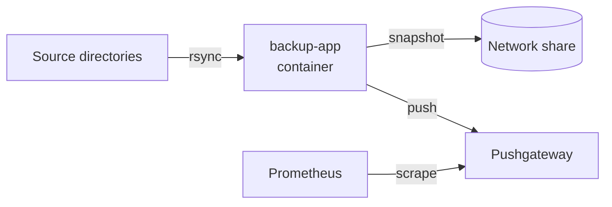

# BackupScript

Daily, space-efficient snapshots of my home server using rsync, containerized and monitored with Prometheus.

## About the project

My home server has grown: it runs containerized services for home automation, Pi-hole, databases and a complete monitoring stack. Until now, there was no backup. This project closes that gap.

A Python script running in a Podman container backs up the mounted source directories once a day to a permanently mounted network share. Each run creates its own timestamped snapshot. Afterwards, the script pushes metrics to a Prometheus Pushgateway, so failed or missing backups show up in the monitoring.



## Features

- **Full snapshots with minimal disk usage:** Unchanged files are hardlinked to the previous snapshot via `--link-dest`. Every snapshot is complete, but only changed files take up additional space.
- **No partial backups:** A run first writes into a `*.incomplete` folder and only renames it after it has finished successfully. Aborted runs are never used as the base for the next snapshot.
- **Protection against the wrong target:** The script checks for a marker file on the backup target. If the network share is not mounted, it aborts instead of writing to the local disk.
- **Automatic rotation:** The 14 most recent snapshots are kept.
- **Monitoring:** Success, duration, time of the last successful backup and rsync statistics are pushed to Prometheus via the Pushgateway.

## Requirements

- Linux host with Podman and `podman-compose` (or `podman compose`)
- A backup target whose file system supports **hardlinks** (e.g. ext4, XFS, Btrfs, or an SMB share backed by NTFS). FAT32 and exFAT are not suitable.

## Installation

### 1. Clone the repository

```bash
git clone https://github.com/Flex0152/backupscript.git
cd backupscript
```

### 2. Configure the paths

Source and target are mounted as volumes in `compose.yaml`. Inside the container, the paths are fixed (`/src` and `/mnt/backup`); only the host paths on the left-hand side need to be adjusted:

```yaml
services:
  backup-app:
    volumes:
      - /mnt/backup/:/mnt/backup        # backup target on the host
      - /path/to/your/data/:/src:ro     # data to back up (read-only)
      - ./app/logs/:/app/logs/
```

### 3. Mark the backup target

The script only writes to a target that contains the marker file `.backuptarget`:

```bash
touch /mnt/backup/.backuptarget
```

### 4. Build and start the stack

```bash
podman compose build
podman compose up -d
```

Prometheus and the Pushgateway keep running. The backup container performs an initial backup on startup and exits afterwards.

### 5. Schedule daily runs

A manual run is possible at any time:

```bash
podman compose run --rm backup-app
```

For daily execution, a systemd timer works well:

```ini
# ~/.config/systemd/user/backup-app.service
[Unit]
Description=Backup via rsync container

[Service]
Type=oneshot
WorkingDirectory=/path/to/repo
ExecStart=/usr/bin/podman-compose run --rm backup-app
```

```ini
# ~/.config/systemd/user/backup-app.timer
[Unit]
Description=Daily backup

[Timer]
OnCalendar=*-*-* 02:00:00
Persistent=true

[Install]
WantedBy=timers.target
```

```bash
systemctl --user enable --now backup-app.timer
loginctl enable-linger "$USER"   # run the timer even when the user is not logged in
```

## Configuration

| Variable          | Default                        | Description                        |
|-------------------|--------------------------------|------------------------------------|
| `PUSHGATEWAY_URL` | `prometheus-pushgateway:9091`  | Address of the Pushgateway         |
| `BACKUP_INSTANCE` | `backup-app`                   | `instance` label of the metrics    |

## Snapshots and restore

Each run creates one folder on the backup target:

```
/mnt/backup/
├── .backuptarget
├── 2026-10-09_02-00-03/
└── 2026-10-10_02-00-02/
```

Every folder contains the complete state at that point in time. To restore, simply copy the desired snapshot back:

```bash
rsync -a /mnt/backup/2026-10-10_02-00-02/ /path/to/destination/
```

## Metrics

| Metric                                    | Meaning                                       |
|-------------------------------------------|-----------------------------------------------|
| `backup_success`                          | `1` if the last run succeeded, otherwise `0`  |
| `backup_last_run_timestamp_seconds`       | Time of the last run                          |
| `backup_last_success_timestamp_seconds`   | Time of the last successful run               |
| `backup_duration_seconds`                 | Duration of the last run                      |
| `backup_files_transferred`                | Number of transferred files                   |
| `backup_total_size_bytes`                 | Total size of the source                      |
| `backup_transferred_bytes`                | Amount of data actually transferred           |
| `backup_snapshots`                        | Number of existing snapshots                  |

Example alerting rules:

```yaml
groups:
  - name: backup
    rules:
      - alert: BackupFailed
        expr: backup_success == 0
      - alert: BackupTooOld
        expr: time() - backup_last_success_timestamp_seconds > 26 * 3600
```

`BackupTooOld` also fires when the backup stops running altogether and therefore cannot report a failure.

## Design decisions

- **Pushgateway instead of an exporter:** The script is a short-lived job that exits after the backup. Prometheus could not scrape it reliably, so it pushes its metrics at the end of each run.
- **`pushadd` instead of `push`:** On failure, `backup_last_success_timestamp_seconds` from the last successful run is preserved instead of being overwritten.
- **No `latest` symlink:** Many network shares do not support symlinks. Instead, the previous snapshot is determined from the sortable timestamp folder names.

## License

This project is released under the [MIT License](LICENSE).